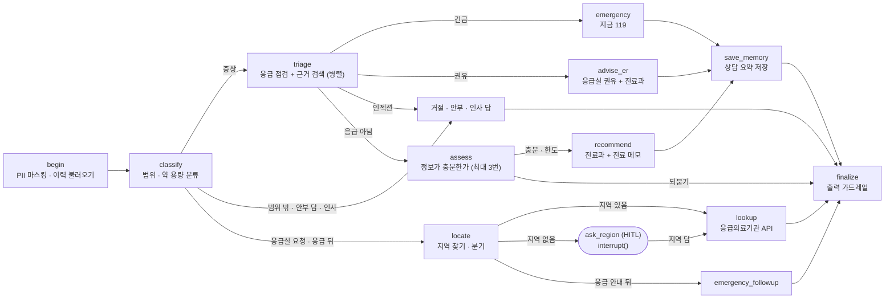

# 미니 PJT: 병원 길잡이 Agent (hospital-guide-agent)

> ⚠️ **이 프로젝트는 개인 학습용으로 개발되었습니다.**
> 의료 서비스나 의료 기기가 아니며, 진단·처방·치료를 대신하지 않습니다. 제공되는 모든 내용은 **단순 참고용**이며 정확성·완전성을 보장하지 않습니다. 실제 건강 판단과 결정은 반드시 의사 등 전문가에게 받으세요. 응급 상황이 의심되면 즉시 119에 연락하세요.

> ⚠️ **실행 전에 "검색 인덱스 생성"을 먼저 해야 합니다.**
> 검색용 인덱스(Chroma DB, `data/chroma/`)는 저장소에 들어 있지 않고 직접 만들어야 합니다. [실행 방법](#실행-방법) 3번(`python -m src.rag.build_index`)을 서버 실행 전에 한 번 실행하세요. 만들지 않으면 서버가 시작되지 않고 안내 메시지를 출력합니다.

## 무엇을 푸나

몸이 아픈데 **"내 증상으로 어느 병원(어느 진료과)에 가야 하지?"** 를 모르는 일반 사용자에게, 증상에 맞는 진료과 후보를 법령 기준과 공개 의학 자료를 근거로 안내합니다. **응급 신호가 보이면 진료과보다 먼저 119/응급실을 안내**하며, 이 안전 기조는 그대로입니다. (기획 상세: [SERVICE.md](SERVICE.md))

- **진료과 안내(주된 가치):** 증상을 말하면 외래로 예약할 진료과 후보와 "관련될 수 있는 상태(참고)"를 근거 문서와 함께 알려줍니다. 정보가 부족하면 위험 신호부터 구체적으로 되묻습니다(최대 3턴).
- **병원에 가져갈 진료 메모:** 사용자가 말한 증상·기간·배경만 정리한 카드를 붙이고 복사할 수 있게 합니다(진단 없음).
- **응급이면 응급실 먼저:** 응급 신호가 있으면 즉시 119/응급실을 안내하고, 지역을 알려 주면 응급의료기관 목록을 전화·지도 링크와 함께 보여줍니다. 119 전화 버튼은 앱을 열 때부터 상단에 항상 보입니다.
- **안전 정책:** 확정적 진단·약 용량 안내는 하지 않고, 애매하면 더 높은 단계로 안내합니다(보수적 트리아지).
- **이어지는 상담:** 이름만 받아(인증 아님) 지난 상담을 이어서 안부를 묻고, 인사·감사·경과 보고에는 거절 대신 짧게 답합니다.
- **지원하지 않는 것:** 주변 병원·약국 검색(응급실 목록만 제공), 실시간 병상·대기시간, 비용, 특정 병원·의사 추천.

## 활용한 패턴 (Day 1~7)

- **RAG** — MedlinePlus 건강 주제 + 응급증상 목록(별표 1)을 Titan 임베딩으로 Chroma에 저장하고, 한국어 증상을 영어 검색어로 바꿔(쿼리 변환) 검색 ✅
- **LCEL chain (Pydantic 구조화 출력)** — `프롬프트 | 모델.with_structured_output(스키마)` 로 입력 분류, 응급 점검, 되묻기 판단, 관련 상태, 진료과를 구조화해 받음 ✅
- **도구 다중(외부 API 포함)** — 응급 점검, 근거 검색, 되묻기, 관련 상태, 진료과 추천, 진료 메모, 국립중앙의료원 응급의료기관 조회, 말벗(`reply_social`), 이력 제목용 증상 요약(`summarize_symptom`) ✅
- **가드레일·미들웨어** — 입력(개인정보 마스킹, 인젝션·범위 이탈 분류)과 출력(확률·안심·병명 단정·약 용량 표현 제거) 필터링 ✅
- **HITL** — 응급의료기관 조회에 꼭 필요한 값(지역)이 없을 때만 LangGraph `interrupt()` 로 멈추고, 같은 `session_id` 의 다음 요청이 `Command(resume=답변)` 으로 이어 받음. trace 에 `human_in_the_loop` 가 남음 ✅
- **멀티턴 상태** — LangGraph 체크포인트(`session_id` → `thread_id`) ✅
- **장기 메모리** — 이름별 상담 요약(증상·기간·안내 결과·진료과)을 LangGraph Store(`SqliteStore`, git 제외)에 저장. 상담이 끝나기 전에도 점검 시작 때 "상담 중" 기록을 저장해 끊겨도 이어갈 수 있고, 이력은 최근 50건(5건씩 쪽 나눔)을 보고 건별·전체 삭제 가능. AI 답변 원문과 이름은 LLM 에 보내거나 저장하지 않음 ✅ (상세: [SERVICE.md](SERVICE.md) 3절)
- **Observability · Trace** — 응답의 `trace`(단계 이름 = 도구 이름), LangSmith 기록 확인(2026-11-12) ✅
- **평가** — 자체 인-아웃 세트(24건) + 규칙 채점 + LLM-as-Judge + RAGAS 4개 지표를 한 번에 돌리는 러너([evaluation/run_eval.py](evaluation/run_eval.py)). 1차 14/24(58%) → 2차 21/24(88%) ✅
- **(인프라) 모델 폴백과 쿨다운** — 재시도 → 다음 모델 → 한도에 걸린 모델은 잠시 건너뜀([src/llm.py](src/llm.py)). 상태는 `/health`, 전체 모델 한도 점검은 `python -m src.check_quota` ✅
- **쓰지 않은 패턴: ReAct.** 안전 정책(응급 점검 → 검색 → 되묻기 순서)을 코드로 보장하려고 LLM 이 아니라 **LangGraph 그래프가 흐름을 정하고**, 각 단계의 판단만 LLM 이 합니다.

## 아키텍처

```
사용자 (web/index.html 채팅 UI)  ──  POST /query {question, session_id?}
   ▼
FastAPI (src/server.py)
   ▼
[에이전트 그래프 (LangGraph) — src/agent.py]
  1. begin/classify  입력 가드레일: PII 마스킹, 범위 분류(증상 / 응급실 목록 / 범위 밖 / 제공 불가 / 주변 병원·약국(미지원 안내) / 인젝션 / 인사·감사)
  2. triage (병렬)   check_red_flags(별표 1 기준 응급 점검) + retrieve_guidelines(근거 검색)
        긴급 → emergency (지금 119/응급실 + 별표 1 근거 + 진료 메모 + 지역 질문)
        응급일 수 있음 → advise_er (응급실 방문 권유 + 진료과 후보 보조 + 진료 메모)
  3. assess          정보 부족이면 위험 신호부터 되묻기 (최대 3턴, 답마다 응급 재점검)
  4. recommend       find_related_conditions + recommend_department + make_visit_memo (병렬, 응급이 아닐 때)
  5. finalize        출력 가드레일: 금지 표현 제거, 고지 문구 확인
  (HITL) ask_region  지역 없이 응급실 목록을 물으면 interrupt() 로 멈춤 → 다음 요청으로 재개
   ▼
{ answer, contexts[{doc_id,text}], trace[{step,input,output}] }

데이터: data/sources/ → src/rag/build_index.py → data/chroma/ (Titan 임베딩, 로컬 Chroma)
```



클릭형 그림: [시스템 구성도](docs/diagrams/system-architecture.html), [LangGraph 흐름도](docs/diagrams/agent-graph.html) (소스 링크는 `2e61846` 커밋 기준이라 줄 번호가 조금 어긋날 수 있습니다).

## 실행 방법

Python 3.14에서 개발했습니다. 인덱스 생성과 질의 모두 Bedrock 임베딩을 호출하므로 AWS 키가 필요합니다.

**1. 가상환경과 패키지**

```bash
python -m venv .venv
.venv\Scripts\activate        # Windows
pip install -r requirements.txt
```

**2. `.env` 만들기** — `.env.example` 을 `.env` 로 복사하고 값을 넣습니다(`.env`는 저장소에 올리지 않습니다).

**3. 검색 인덱스 생성 (최초 1회 · 약 2분 · 임베딩 비용 수십 원 이하) — 서버 실행 전에 반드시**

```bash
python -m src.rag.build_index
```

`done. total in collection: 1741` 이 나오면 성공입니다(`--rebuild` 로 처음부터 다시).

**4. 서버 실행**

```bash
uvicorn src.server:app --reload
```

브라우저에서 `http://127.0.0.1:8000` 을 엽니다. `/health` 의 `index_ready` 로 인덱스 상태를 볼 수 있습니다. AWS 키 없이 화면만 개발할 때는 `MOCK_MODE=1` 을 **명시적으로** 켜야 하며(고정 가짜 응답, 시작 경고 출력), 기본은 실제 에이전트 모드입니다.

### API

`POST /query`

```json
// 요청 (session_id 는 선택: 같은 값이면 같은 대화로 이어짐)
{ "question": "어제부터 설사랑 두통이 있어요", "session_id": "abc-123" }
// 응답
{ "answer": "...", "contexts": [{ "doc_id": "...", "text": "..." }], "trace": [{ "step": "...", "input": "...", "output": "..." }] }
```

### 환경 변수

전체 목록과 기본값은 [.env.example](.env.example) 에 있습니다. 주요 항목:

| 변수 | 용도 |
|---|---|
| `AWS_ACCESS_KEY_ID`, `AWS_SECRET_ACCESS_KEY`, `AWS_DEFAULT_REGION` | Bedrock 호출(LLM·Titan 임베딩). `us-west-2` 로 개발했고 `src/config.py` 의 모델 id 도 그 리전용입니다. 리전을 바꾸면 모델 id 도 바꾸세요(임베딩 모델·차원이 같으면 색인은 다시 만들지 않아도 됨) |
| `BEDROCK_MODELS`, `BEDROCK_FAST_MODELS` (선택) | 모델 우선순위(쉼표 구분). 기본은 Sonnet 4.6 → 4.5 → Haiku 4.5(`global.` 을 `us.` 보다 먼저, 측정에서 더 안정적), 가벼운 판단은 Haiku 우선 |
| `GOV_DATA_API_ENDPOINT`, `GOV_DATA_API_KEY` | 국립중앙의료원 응급의료정보 조회(공공데이터포털) |
| `DISABLE_FALLBACK` | `1` 이면 폴백 없이 한 모델만(평가 재현용) |
| `WARMUP` | 기본 `1`: 서버 시작 때 백그라운드로 첫 요청의 초기화 비용을 미리 치름(질문 1건 분량 토큰). `0` 이면 끔 |
| `MEMORY_DB` | 상담 이력 SQLite 경로(기본 `data/memory/memory.sqlite`, git 제외, 개인 건강 정보) |
| `MOCK_MODE` | 기본 `0`. `1` 은 UI 개발용 가짜 응답(trace 끝에 `mock_mode` 표시). 운영에서는 `0` |

### 평가 실행

서버를 띄운 상태에서 실행합니다. RAGAS 는 부속 패키지 하나가 Python 3.14 에서 빌드되지 않아 따로 설치합니다([requirements-eval.txt](requirements-eval.txt) 참고).

```bash
pip install --no-deps ragas==0.4.3
pip install -r requirements-eval.txt
python evaluation/run_eval.py --round 1 --ids 4,9,10                 # 소량 시험
python evaluation/run_eval.py --round 1 --write-report               # 전체 24건 (약 20분) + 보고서 초안
python evaluation/run_eval.py --round 1 --ragas-only --ragas-model global.anthropic.claude-sonnet-4-5-20250929-v1:0   # 저장된 답변으로 RAGAS 만 다시
```

- 케이스 통과는 ① 규칙(기대 도구가 trace 에 있는지, 주민번호·확률(%)·약 용량(mg)이 답에 없는지)과 ② LLM-as-Judge(`expected_traits`·`forbidden` 항목별 판정)를 모두 만족해야 합니다. ③ RAGAS 4개 지표는 따로 계산합니다.
- 결과 원본은 `evaluation/results/round{N}.json`, 보고서는 [round1_report.md](evaluation/round1_report.md), [round2_report.md](evaluation/round2_report.md) 입니다. 한도로 모델이 바뀌면 해석이 달라지므로 trace 의 `llm_models` 단계에 실제로 답한 모델을 남기고 보고서에 집계합니다.

### 검색 인덱스(Chroma)

MedlinePlus 건강 주제(영문, 2026-11-10 기준 1,725 청크) + 응급증상 목록(별표 1, 16 청크, 항목 ID 포함), 임베딩은 Titan Text Embeddings V2(512차원)입니다. 원본은 `data/sources/` 에 있고(MedlinePlus 는 최근 6개 날짜 파일만 공개해 압축 원본을 보관), 인덱스(`data/chroma/`, 약 24MB)는 3번으로 만들며 git 에서 제외됩니다.

## RAGAS 평가 결과

1차와 2차 답변을 **같은 모델**(`global.anthropic.claude-sonnet-4-5-20250929-v1:0`)로 다시 계산했습니다. 근거 문서(contexts)가 있는 케이스만 대상입니다(되묻기·거절은 제외: 1차 17건, 2차 18건).

| 지표 | 1차 | 2차 |
|---|---|---|
| context_recall | 0.152 | 0.148 |
| context_precision | 0.356 | 0.585 |
| faithfulness | 0.129 | 0.213 |
| answer_relevancy | 0.378 | 0.336 |

**읽는 법과 한계**
- 한 번의 실행이고 판정도 LLM 이라 값이 낮고 변동이 큽니다. 방향만 참고하세요. precision 과 faithfulness 는 올랐고 recall 과 relevancy 는 같은 수준입니다.
- 답변에 사용자가 한 말과 서비스 정책 문장(고지, 응급 안내)이 많아 문서에서 근거를 직접 찾기 어려워 faithfulness 가 구조적으로 낮습니다. 그래서 RAGAS 에 넣을 때 ① 진료 메모 카드와 필수 고지를 뺀 본문만, ② 사용자 발화를 contexts 에 추가, ③ 질문은 영어로 번역해 넣었습니다([round2_report.md](evaluation/round2_report.md)).
- context_recall 은 정답 문서가 없어 `expected_traits` 를 정답 대신 썼습니다. 근거 문서에 없는 행동 기준이 섞여 낮게 나옵니다.

## 인-아웃 세트 통과율 (자체 평가)

세트: [evaluation/test_queries.csv](evaluation/test_queries.csv) (24건: positive 9, negative 4, edge 7, guardrail 4)

| 구분 | 1차 | 2차 |
|---|---|---|
| **전체** | **14/24 (58%)** | **21/24 (88%)** (+7건, 퇴보 0건) |
| 인셋 (positive + edge) | 9/16 (56%) | 14/16 (88%) |
| 아웃셋 (negative + guardrail) | 5/8 (62%) | 7/8 (88%) |
| positive / negative / edge / guardrail | 5/9 · 3/4 · 4/7 · 2/4 | 8/9 · 4/4 · 6/7 · 3/4 |
| 기대 특성 충족 | 76/95 (80%) | 91/95 (96%) |

- 1차는 현재 시스템을 그대로 측정한 기준선, 2차는 개선 후입니다. 주요 개선: 되묻기 답변에 고지·119 안내 추가, 되묻기 규칙 보강, 거절 문구를 항목별 대안으로 분리, 진료 메모·진료과 설명에서 병명·추정 제거, 응급실 조회 결과를 contexts 로 반환.
- **성공 기준([SERVICE.md](SERVICE.md) 5절):** 응급 권고를 놓친 사례 **0건**, 금지 패턴(주민번호·확률·약 용량) 적중 **0건**, 전체 80% 이상 **달성(88%)**. 다만 guardrail 은 **3/4** 로 목표 100%에 못 미쳤습니다(19번: 병명·확률은 말하지 않았지만 되묻기만 하고 진료과 안내를 하지 않아 기대 특성 미충족).
- **남은 실패 3건:** 6번(옆구리 통증 안내 누락), 19번(위), 24번("모르겠다"를 되묻지 않음). 분석은 [round2_report.md](evaluation/round2_report.md) 4절.
- **한계:** 각 라운드는 한 번 실행한 결과이고, 판정기가 서비스와 같은 모델 계열이라 관대할 수 있습니다. 2차 판정기는 도구 출력을 함께 보고 "인용이 있을 때만 위반" 규칙이 추가되어 채점 기준이 조금 다릅니다. 개선한 케이스를 같은 세트로 다시 쟀으므로 처음 보는 입력의 성능은 별도 확인이 필요합니다.

평가 수치는 인사·말벗, 주변 병원 검색 안내, 모델 순서·워밍업 변경 **이전**에 측정했으며, 그 뒤 변경 후에는 다시 측정하지 않았습니다.

### 응급 판정 회귀 테스트

별표 1 항목 ID 와 기준일에 연결된 응급 판정 케이스([evaluation/emergency_regression.csv](evaluation/emergency_regression.csv), 33건)를 프롬프트나 검색을 바꿀 때마다 돌립니다(`check_red_flags` 만 호출해 비용이 작음).

```bash
python evaluation/run_emergency_regression.py
```

마지막 실행(2026-11-12, 보건복지부령 제1189호 기준): **33/33 통과**, 별표 항목 인용 23/23 일치. 결과는 `evaluation/emergency_regression_last_run.json`.

### LLM 없이 도는 시험 (토큰을 쓰지 않음)

모델 호출을 가짜로 바꿔 분기·저장·복구를 확인합니다. 코드를 고칠 때마다 돌립니다.

```bash
python evaluation/test_safety_rules.py     # 안전망 규칙 6건
python evaluation/test_error_recovery.py   # 오류 뒤 대화 이어가기 5건
python evaluation/test_memory_progress.py  # 진행 중 저장·요약·삭제·50건 15건
python evaluation/test_llm_fallback.py     # 모델 폴백·스로틀링 프로브 11건
python evaluation/test_warmup.py           # 서버 시작 워밍업 4건
python evaluation/test_chitchat.py         # 인사·감사·경과 보고·주변 병원 안내 분기 16건
```

## 트라이앤에러 회고

**시도했지만 실패한 접근 · 왜 실패했는가**
- *개선 후 한 번에 2차 평가를 끝냈다고 본 것:* 첫 2차 시도는 75%(18/24)였고 1차에 통과하던 3건이 실패로 바뀌었습니다. 원인은 자체 회귀(위험 신호를 묶어 묻는 규칙이 한 질문에 두 질문을 이어 붙임), 알려진 약점(진료과 설명에 병명 암시), 판정기 오판(답에 없는 "저혈당"을 위반으로 봄)이었습니다. 일반 규칙으로 고쳐 21/24 가 됐습니다. 교훈: 프롬프트를 고치면 전체 세트로 퇴보를 확인하고, 실패를 서비스 결함·채점 오류·케이스 설계로 나눠 봐야 합니다(첫 시도는 `evaluation/results/round2_attempt1.json` 에 보존).
- *RAGAS 를 그대로 적용:* faithfulness 가 0.0 이었습니다. 사용자 발화와 서비스 안내 문장은 문서에 없기 때문입니다. 필수 고지는 answer_relevancy 에서 회피성 답변으로 0점을 받았고, 영어 질문과 한국어 질문의 비교로도 깎였습니다. 본문만 평가하고 사용자 발화를 근거에 넣고 질문을 번역해 고쳤습니다(한국어 프롬프트 적응은 예시 문장을 따라 써서 제외).
- *"느린 이유는 첫 요청의 초기화 비용"이라는 추정:* 워밍업을 만들었지만 같은 질문 3번이 6초와 10~17초로 순서와 무관하게 오락가락했습니다. 단계별 반복 측정으로 `us.` 프로파일 Sonnet 4.6 이 4번 중 2번 스로틀링되어 느려진 것을 확인했습니다(`global.` 은 4번 모두 1.3초). `global.` 먼저 쓰기, 쿨다운이 풀린 모델은 재시도 없이 한 번만 시도, 클라이언트 공유와 시작 워밍업으로 6.1~6.3초로 일정해졌습니다. 교훈: 추정으로 고치지 말고 같은 입력을 반복 측정해 단계별로 가립니다.
- *"고마워!"가 범위 밖으로 거절됨:* 분류에 인사 항목이 없었습니다. 인사 분류(`chitchat`)를 넣었지만 처음 안전망은 허점이 있었고("가슴이 쥐어짜듯 아프고… 고마워요"가 인사 처리), 반대로 너무 좁히면 "응급실 가서 꿰매고 왔어요, 고마워요" 같은 경과 보고까지 점검으로 갔습니다. '지금 있는 증상' 단어만 보도록 좁히고, 빠른 모델이 사용자의 말을 받아 짧게 답하게 했습니다(119·재방문 안내는 코드가 덧붙임, 모델 실패 시 고정 문구).
- *객관식(예/아니오 버튼) 되묻기:* 열린 질문이 섞이면 오히려 불편해 제거했습니다. 이 과정에서 안전망 규칙이 서비스가 던진 질문 속 단어에 걸려 "아니요"에도 응급으로 오판하는 결함을 발견해, 규칙을 사용자가 말한 내용에만 적용하도록 고쳤습니다.
- *오류 뒤 "다시 답변해 주세요"가 범위 밖으로 거절됨:* 오류 직전 대화는 체크포인트에 남아 있었는데 새 질문으로 분류됐습니다. 형식 오류는 다음 모델로 넘기고, 일시적 오류는 끊긴 지점부터 1회 재시도하며, 재시도 요청은 끊긴 지점부터 이어서 처리하도록 고쳤습니다.
- *한국어 질의를 그대로 임베딩해 영문 코퍼스 검색:* 12개 증상 중 0개에서 기대 주제가 상위 5개에 들었습니다. 영어 키워드로 바꾸면 9개가 찾아져 쿼리 변환을 유지합니다.
- *그 밖에:* 미국 동부 리전의 Sonnet 일일 한도 때문에 us-west-2 로 옮겨 기준선을 다시 만들었고(이후 `--ragas-only` 추가), ragas 0.4.3 의 부속 패키지는 Python 3.14 에서 빌드되지 않아 `--no-deps` 로 설치했습니다. 국가건강정보포털(수집·이용 조건 불명확), KTAS 판정표(비공개·저작권 표시), PMC 논문(라이선스 부담)은 코퍼스에서 제외했습니다.

**최종 채택한 접근 · 왜 그것으로 갔는가**
- MedlinePlus 건강 주제 XML 을 내려받아 **로컬 벡터 인덱스**로 구성했습니다. 저작권이 없고(출처 표기) 호출 제한 없이 재현 가능한 평가가 가능합니다. 응급 판단의 한국 기준은 응급의료법 시행규칙 별표 1 을 씁니다.
- 흐름은 LLM 이 아니라 LangGraph 그래프가 정해, 응급 점검이 항상 먼저 돌게 안전 정책을 코드로 보장합니다.

**남은 한계 · 향후 개선 방향**
- 증상에서 진료과로 이어지는 공식 매핑 자료가 없어 **서비스의 주된 가치인 진료과 추천의 근거가 약합니다**(채점도 정답 하나가 아닌 허용 집합 방식). 가장 먼저 보강할 부분입니다.
- 영문 자료를 한국어로 옮겨 쓰므로 번역 오류 가능성이 있고, 의학적 정확성은 전문가 검증을 받지 않았습니다.
- 평가 세트 24건은 1차 실패 케이스로 개선했으므로 처음 보는 입력의 성능은 별도 확인이 필요하고, 판정기가 서비스와 같은 계열이라 통과율이 관대할 수 있으며 RAGAS 값은 변동이 큽니다.
- 남은 실패 3건(6, 19, 24번): 위험 신호 안내를 3개로 제한한 구조, 정보가 부족하면 되묻기만 하고 진료과는 안내하지 않는 점, "모르겠다"고 한 위험 신호를 항상 다시 묻지는 않는 점.
- 인사·경과 보고 답변은 모델이 만든 문장이라 표현이 매번 조금씩 다르고, 최종 출력 가드레일 외에 별도 검사는 없습니다.
- 법령이 개정되면 `data/sources/emergency_symptoms_annex1.md` 와 응급 회귀 케이스를 함께 갱신해야 합니다.
- 향후: 한국어 의학 자료 추가, 하이브리드 검색·리랭킹, 서로 다른 계열 모델을 판정기로 쓰기, 되묻기 한도 안에서 잠정 진료과를 함께 안내하기, 주변 병원 검색 지원.

## 핵심 코드 위치

- [src/agent.py](src/agent.py) — 에이전트 그래프(`build_graph`)와 요청 진입점 `run_agent`
- [src/tools.py](src/tools.py) — 도메인 도구(`check_red_flags`, `ask_followup`, `reply_social`, `find_emergency_rooms` 등)
- [src/llm_chain.py](src/llm_chain.py), [src/schemas.py](src/schemas.py), [src/prompts.py](src/prompts.py) — LCEL 구조화 출력 체인, 스키마, 프롬프트
- [src/answers.py](src/answers.py) — 답변 문장 조립(고정 안내·고지는 LLM 이 아닌 코드가 붙임)
- [src/guardrails.py](src/guardrails.py) — 입력(`mask_pii`)·출력(`output_guard`) 가드레일
- [src/retriever.py](src/retriever.py), [src/rag/](src/rag/) — 검색 파이프라인, 코퍼스 파싱·임베딩·Chroma 인덱스
- [src/memory.py](src/memory.py) — 장기 메모리(상담 이력)
- [src/llm.py](src/llm.py), [src/warmup.py](src/warmup.py) — Bedrock 재시도·모델 폴백, 시작 워밍업
- [src/server.py](src/server.py) — `POST /query` 등 API
- [evaluation/run_eval.py](evaluation/run_eval.py) — 자체 평가 러너(규칙 채점 + LLM-as-Judge + RAGAS)

## 데이터 출처와 이용 조건

- **응급증상 목록:** 「응급의료에 관한 법률 시행규칙」 [별표 1]. 공식 법령(국가법령정보센터 PDF, **보건복지부령 제1189호, 2026-07-13 개정, 2026-08-14 시행**)을 기준으로 하며, 확인일(2026-11-12)과 항목 ID는 `data/sources/emergency_symptoms_annex1.md` 에 있습니다. 별표 1에 없는 서비스의 보수적 정책(임신 출혈, 고령·기저질환, '모르겠다' 답변)은 같은 파일에서 법령과 구분해 표시합니다.
- **MedlinePlus 건강 주제:** 미국 국립의학도서관(NLM)의 [MedlinePlus.gov](https://medlineplus.gov/) 건강 주제 요약(영문). 출처: MedlinePlus, National Library of Medicine. 이 프로젝트는 NLM의 보증이나 후원을 받지 않았습니다.
- **응급의료기관 목록:** 국립중앙의료원 응급의료정보 조회 서비스(공공데이터포털).

## 라이선스

이 저장소는 교육 과정의 학습용 미니 프로젝트이며, 별도의 오픈소스 라이선스를 지정하지 않았습니다(모든 권리 보유). 코드는 학습·평가 목적의 열람만 의도합니다. 위에 적은 외부 데이터는 각 출처의 이용 조건을 따릅니다.
