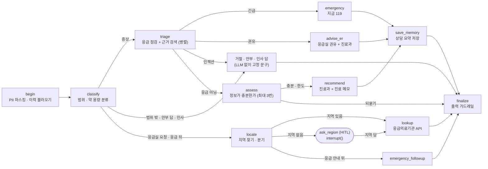

# 미니 PJT: 병원 길잡이 Agent (hospital-guide-agent)

> ⚠️ **이 프로젝트는 개인 학습용으로 개발되었습니다.**
> 의료 서비스나 의료 기기가 아니며, 진단·처방·치료를 대신하지 않습니다. 제공되는 모든 내용은 **단순 참고용**이며 정확성·완전성을 보장하지 않습니다. 실제 건강 판단과 결정은 반드시 의사 등 전문가에게 받으세요. 응급 상황이 의심되면 즉시 119에 연락하세요.

> ⚠️ **실행 전에 "검색 인덱스 생성"을 반드시 먼저 해야 합니다.**
> 검색용 인덱스(Chroma DB, `data/chroma/`)는 저장소에 들어 있지 않고 **직접 만들어야** 합니다. 아래 [실행 방법](#실행-방법)의 3번(`python -m src.rag.build_index`)을 서버 실행 전에 한 번 실행하세요. 만들지 않으면 서버가 시작되지 않고 안내 메시지를 출력합니다.

## 무엇을 푸나

몸이 아플 때 **"지금 응급실에 가야 하는지, 외래라면 어느 진료과로 가야 하는지"** 를 판단하지 못하는 일반 사용자에게, 법령 기준과 공개 의학 자료를 근거로 안내합니다. (기획 상세: [SERVICE.md](SERVICE.md))

- 응급 신호가 있으면 즉시 119/응급실을 안내합니다.
- 정보가 부족하면 위험 신호부터 구체적으로 되묻습니다(최대 3턴).
- 응급이 아니라고 판단되면 "관련될 수 있는 상태(참고)"와 진료과 후보를 안내합니다(사용한 근거 문서는 답변 아래 "근거 문서"에서 확인).
- 안내 끝에 병원에서 의사에게 보여 줄 **진료 메모**(사용자가 말한 증상·기간·배경만, 진단 없음)를 카드로 붙이고 복사할 수 있게 합니다.
- **119 전화 버튼은 앱을 열 때부터 상단에 항상 보이고**(응급 안내 밴드에도 따로 있음), 글을 치기 어려울 만큼 급할 때도 바로 전화를 걸 수 있습니다.
- 응급이면 **119 전화 버튼**을 보여 주고, 지역을 알려 주면(또는 "근처 응급실 알려줘"라고 직접 물으면) 응급의료기관 목록을 **전화·지도(카카오맵, 네이버지도, 도로명 주소로 검색) 링크**와 함께 안내합니다.
- 확정적 진단·약 용량 안내는 하지 않고, 애매하면 더 높은 단계로 안내합니다(보수적 트리아지).
- 인사·감사나 "시킨 대로 응급실 다녀왔어요, 고마워요" 같은 경과 보고에는 거절 문구가 아니라 사용자의 말을 받아 짧게 답합니다(지금 증상이 있으면 정상 점검).

## 활용한 패턴 (Day 1~7)

상태: ✅ 완료 · 🚧 구현 예정

- Day 2: **RAG** — MedlinePlus 건강 주제 + 응급증상 목록(별표 1)을 Titan 임베딩으로 Chroma에 저장. 한국어 증상을 영어 검색어로 바꿔 검색(쿼리 변환). ✅
- Day 1: **LCEL chain (Pydantic 구조화 출력)** — `프롬프트 | 모델.with_structured_output(스키마)` 체인으로 입력 분류, 응급 점검, 되묻기 판단, 관련 상태, 진료과를 구조화해 받음 ✅
- Day 4: **도구 다중(외부 API 포함)** — 응급 점검, 근거 검색, 되묻기, 관련 상태, 진료과 추천, 진료 메모 생성, 국립중앙의료원 응급의료기관 조회, 인사·경과 보고에 답하는 말벗(`reply_social`), 이력 제목용 증상 요약(`summarize_symptom`) ✅
- Day 5: **가드레일·미들웨어** — 입력(개인정보 마스킹, 프롬프트 인젝션·범위 이탈 분류)과 출력(확률·안심·병명 단정·약 용량 표현 제거) 필터링 ✅
- Day 5: **HITL (Human-in-the-loop)** — 응급의료기관 조회에 **꼭 필요한 값(지역)이 없을 때만** LangGraph `interrupt()` 로 그래프를 멈추고, 같은 `session_id` 의 다음 요청이 `Command(resume=답변)` 으로 그 지점에서 이어 받음. 되묻기나 응급 안내 뒤의 대화는 멈추지 않고 새 턴으로 처리함(매 답마다 응급 점검부터 다시 해야 해서). trace 에 `human_in_the_loop` 단계가 남음 ✅
- Day 5: **멀티턴 상태** — 대화 상태를 LangGraph 체크포인트(`session_id` → `thread_id`)로 유지 ✅
- Day 6: **장기 메모리** — 이름만 받아(인증 아님) 사용자별 **상담 요약**(증상·기간·안내 결과·진료과)을 LangGraph Store(`SqliteStore`, `data/memory/memory.sqlite`, git 제외)에 저장하고, 다음 방문 때 첫 화면에서 최근 상담을 바탕으로 안부를 묻고("증상은 좀 나아지셨나요?", "응급실에서 진료는 받으셨나요?") 첫 화면에는 지난 상담 요약(최근 2건, 보기만 가능)을, 상단 "이력 불러오기" 메뉴에는 최근 50건(5건씩 쪽 나눔)을 보여주며 건별·전체 삭제는 이 메뉴에서만 할 수 있고, 앱을 열 때마다 이름 입력 화면부터 나오며(지난 이름은 미리 채워 줌), 이력을 누르면 저장된 진료 카드를 팝업으로 보여줌. 상담이 끝나기 전에도 증상 점검이 시작될 때 "상담 중" 기록을 바로 저장하고(저장은 LLM 호출 없음, 제목은 빠른 모델이 백그라운드에서 "손등 열상(3cm)" 같은 짧은 증상명으로 줄여 인사말이 어색하지 않게 함) 중간에 끊겨도 다음 방문 때 이어서 안내함. 새 대화 첫 턴에 `load_memory`, 상담이 끝나면 `save_memory` 가 trace 에 남음. 안부에 "나아졌어요"라고만 답하면 점검 없이 짧게 맺고(`checkin_reply`), "아직 아파요"는 지난 기록을 참고만 하고 현재 증상으로 다시 점검. 요약은 진료 메모에서 가져와 **추가 LLM 호출이 없고**, 이름은 LLM 에 보내지 않으며 AI 답변 원문은 저장하지 않음(진료 메모 원문과, 끝나지 않은 상담의 사용자 문장 최대 6개는 마스킹해 저장). 이력은 화면에서 지울 수 있음 ✅
- Day 7: **Observability · Trace** — 응답의 `trace`(단계 이름 = 도구 이름) ✅ / LangSmith 에 실행 트레이스가 정상 기록되는 것을 확인함(2026-11-12) ✅
- Day 7: **평가** — 자체 인-아웃 세트(24건) + 규칙 채점 + LLM-as-Judge + RAGAS 4개 지표를 한 번에 돌리는 러너([evaluation/run_eval.py](evaluation/run_eval.py)). 1차 14/24(58%) → 개선 → 2차 21/24(88%). 서비스가 실제로 어떤 모델로 답했는지도 trace 의 `llm_models` 단계에 남겨 평가 보고서에 기록함 ✅ (결과는 아래 [RAGAS 평가 결과](#ragas-평가-결과), [인-아웃 세트 통과율](#인-아웃-세트-통과율-자체-평가))
- (인프라) Bedrock 호출 재시도 → 모델 폴백 → **쿨다운(차단기)** ✅ — [src/llm.py](src/llm.py). 한도(스로틀링)에 걸린 모델은 일정 시간 건너뛰어, 매 호출마다 재시도로 시간을 버리지 않음. 하루 한도로 쉬던 모델이 쿨다운에서 풀린 뒤 첫 호출은 재시도 없이 한 번만 시도해, 한도가 그대로면 대기 없이 다음 모델로 넘어감(하루 한도와 일반 스로틀링 모두 적용, `python evaluation/test_llm_fallback.py`, 11건). 건너뛰는 모델은 `/health` 의 `model_cooldowns` 에서 확인. 설정된 모든 모델이 하루 한도에 도달하면 `/health` 의 `quota_alert.all_daily_limited` 가 `true` 가 되고 서버 로그에 CRITICAL 이 남으며, 이때 `/query` 는 오류 대신 "한도 때문에 답변하지 못함, 응급이면 119" 안내를 돌려줌. 알려진 모든 모델(11개, us-west-2 기준)의 한도 상태는 `python -m src.check_quota` 로 점검(전부 한도면 종료 코드 2)
- 쓰지 않은 패턴: **ReAct**(`bind_tools`로 모델이 도구를 고르게 하는 방식). 안전 정책(응급 점검 → 검색 → 되묻기 순서)을 코드로 보장하려고 LLM이 아니라 **LangGraph 그래프가 흐름을 정하고**, 각 단계의 판단만 LLM이 합니다.

## 아키텍처

```
사용자 (web/index.html 채팅 UI)
   │  POST /query {question, session_id?}
   ▼
FastAPI (src/server.py)
   ▼
[에이전트 그래프 (LangGraph) — src/agent.py]
  1. begin/classify      입력 가드레일: PII 마스킹, 범위 분류(증상 / 범위 밖 / 제공 불가 / 인젝션 / 인사·감사). 인사·감사·지난 상담 뒤 경과 보고('고마워요', '시킨 대로 응급실 가서 꿰매고 왔어요')는 점검 없이 빠른 모델이 사용자의 말을 받아 짧게 답하고(의학 판단·당부 금지, 119·재방문 안내는 코드가 덧붙임, 모델이 실패하면 고정 문구), '지금' 증상 단어가 섞였으면 정상 점검
  2. triage (병렬)       check_red_flags(별표 1 기준 응급 점검) + retrieve_guidelines(근거 검색)
        (누가 봐도 응급인 표현이 규칙에 걸리면 MedlinePlus 검색은 시작하지 않고 바로 응급 안내: 응급 답변은 별표 1 근거만 쓰므로)
        긴급(별표 1 응급증상) → emergency: 검정 띠, 지금 바로 119/응급실 + 별표 1 근거 + 진료 메모(make_visit_memo, 병렬) + 지역 질문
        응급일 수 있음 → advise_er: 호박색 띠, 부드러운 응급실 방문 권유 + 진료과 후보(보조) + 바로 119 신호 + 진료 메모 + 지역 질문
        인젝션(증상 없음) → 거절
  3. assess              ask_followup: 정보 부족이면 위험 신호부터 되묻기 (최대 3턴, 답마다 응급 재점검)
  4. recommend           find_related_conditions + recommend_department + make_visit_memo (병렬, 응급이 아닐 때만)
  5. finalize            출력 가드레일: 금지 표현 제거, 고지 문구 확인
  (HITL) ask_region      응급실 목록을 물었는데 지역이 없으면 interrupt() 로 멈춤 → 다음 요청이 Command(resume) 으로 재개 → 지역이면 조회, 아니면 새 입력으로 1번부터
  (응급 안내 다음 턴) locate: 사용자가 알려준 지역으로 find_emergency_rooms 조회
   ▼
{ answer, contexts[{doc_id,text}], trace[{step,input,output}] }

데이터: data/sources/ (별표 1 목록, MedlinePlus 원본 zip)
        → src/rag/build_index.py → data/chroma/ (Titan 임베딩, 로컬 Chroma)
```

LangGraph 그래프의 분기를 그림으로 보면 다음과 같습니다(주 경로는 `begin → classify → triage → assess → recommend → save_memory → finalize`).



소스 줄 번호가 달린 클릭형 그림도 저장소에 있습니다(브라우저로 열기): [시스템 구성도](docs/diagrams/system-architecture.html), [LangGraph 흐름도](docs/diagrams/agent-graph.html). 그림의 소스 링크는 `2e61846` 커밋 기준입니다. 이후 코드가 바뀌면 줄 번호는 조금 어긋날 수 있습니다.

## 실행 방법

Python 3.14에서 개발했습니다. 인덱스 생성과 질의 모두 Bedrock 임베딩을 호출하므로 AWS 키가 필요합니다.

**1. 가상환경과 패키지**

```bash
python -m venv .venv
.venv\Scripts\activate        # Windows
pip install -r requirements.txt
```

**2. `.env` 만들기** — `.env.example` 을 `.env` 로 복사하고, 아래 "환경 변수" 표를 보고 값을 넣습니다. (`.env`는 저장소에 올리지 않습니다.)

**3. 검색 인덱스 생성 (최초 1회 · 약 2분 · 임베딩 비용 수십 원 이하) — 서버 실행 전에 반드시**

```bash
python -m src.rag.build_index
```

`done. total in collection: 1741` 이 출력되면 성공입니다. 처음부터 다시 만들려면 `--rebuild` 를 붙입니다.

**4. 서버 실행**

```bash
uvicorn src.server:app --reload
```

브라우저에서 `http://127.0.0.1:8000` 을 엽니다. 기본은 실제 에이전트 모드(`MOCK_MODE=0`)입니다. 검색 인덱스나 AWS 키 없이 화면만 개발할 때는 **명시적으로** `MOCK_MODE=1` 을 켜야 하며, 이때는 고정 가짜 응답이 나가고 서버 시작 시 경고가 출력됩니다. `http://127.0.0.1:8000/health` 의 `index_ready` 로 인덱스 상태를 확인할 수 있습니다.

### API

`POST /query`

```json
// 요청 (session_id 는 선택: 같은 값이면 같은 대화로 이어짐)
{ "question": "어제부터 설사랑 두통이 있어요", "session_id": "abc-123" }
// 응답
{ "answer": "...", "contexts": [{ "doc_id": "...", "text": "..." }], "trace": [{ "step": "...", "input": "...", "output": "..." }] }
```

### 환경 변수

| 변수 | 용도 |
|---|---|
| `AWS_ACCESS_KEY_ID`, `AWS_SECRET_ACCESS_KEY`, `AWS_DEFAULT_REGION` | Amazon Bedrock 호출. 리전은 `us-west-2` 로 개발했고(LLM 과 Titan 임베딩이 같은 설정을 씀), 코드의 모델 목록도 이 리전에서 쓸 수 있는 id 입니다. 리전을 바꾸면 `src/config.py` 의 모델 id 도 그 리전용으로 바꾸세요. 임베딩 모델·차원이 같다면 리전을 바꿔도 색인을 다시 만들 필요는 없습니다 |
| `BEDROCK_MODELS` (선택) | 모델 우선순위(쉼표 구분). 기본은 Claude Sonnet 4.6 → Sonnet 4.5 → Haiku 4.5 (`global.` 과 `us.` 추론 프로파일을 번갈아 폴백, 측정에서 더 안정적이었던 `global.` 을 먼저) |
| `BEDROCK_MAX_ATTEMPTS`, `BEDROCK_READ_TIMEOUT` | 모델별 재시도 횟수, 읽기 제한 시간 |
| `BEDROCK_FAST_MODELS` (선택) | 가벼운 판단(분류, 질의 변환, 되묻기, 메모 등)에 쓰는 모델 우선순위. 기본은 Haiku 우선 |
| `MODEL_DAILY_COOLDOWN_S`, `MODEL_THROTTLE_COOLDOWN_S` | 하루 토큰 한도에 걸린 모델을 건너뛰는 시간(기본 300초, 실제로는 몇 분 안에 풀리는 일이 많아 짧게 두고 다시 시험), 일반 스로틀링일 때(기본 60초) |
| `DISABLE_FALLBACK` | `1`이면 폴백 없이 한 모델만 사용(평가 재현용) |
| `WARMUP` | 기본 `1`: 서버 시작 때 백그라운드로 그래프·색인·모델 연결을 데우고 실제 처리 경로를 한 번 돌려(질문 1건 분량의 토큰) 첫 질문이 느리지 않게 함. `0` 이면 끔 |
| `GOV_DATA_API_ENDPOINT`, `GOV_DATA_API_KEY` | 국립중앙의료원 응급의료정보 조회 서비스(공공데이터포털) |
| `LANGSMITH_*` (선택) | 트레이싱 |
| `MEMORY_DB` | 장기 메모리(상담 이력) SQLite 파일 경로. 기본 `data/memory/memory.sqlite` (git 제외, 개인 건강 정보라 올리지 말 것) |
| `MOCK_MODE` | 기본 `0`(실제 에이전트). `1`을 명시해야 UI 개발용 고정 응답이 나가며, 이때 시작 경고와 모든 응답 trace 끝의 `mock_mode` 단계로 가짜 응답임이 표시됨. 운영에서는 `0` 유지 |

### 평가 실행

서버를 띄운 상태에서 자체 평가 세트를 돌립니다. RAGAS 는 부속 패키지 하나가 Python 3.14 에서 빌드되지 않아 따로 설치합니다([requirements-eval.txt](requirements-eval.txt) 상단 설명 참고).

```bash
pip install --no-deps ragas==0.4.3
pip install -r requirements-eval.txt
python evaluation/run_eval.py --round 1 --ids 4,9,10                 # 소량 시험
python evaluation/run_eval.py --round 1 --write-report               # 전체 24건 (약 20분) + 보고서 초안
python evaluation/run_eval.py --round 1 --ragas-only --ragas-model global.anthropic.claude-sonnet-4-5-20250929-v1:0   # 저장된 답변으로 RAGAS 만 다시
```

- 채점은 세 가지입니다. ① 규칙(기대 도구가 trace 에 있는지, 주민번호·확률(%)·약 용량(mg)이 답에 없는지) ② LLM-as-Judge(`expected_traits` 를 항목별로, `forbidden` 을 항목별로 판정) ③ RAGAS 4개 지표. 케이스 통과는 ①②를 모두 만족해야 합니다.
- 결과 원본은 `evaluation/results/round{N}.json`, 사람이 읽는 보고서는 [round1_report.md](evaluation/round1_report.md), [round2_report.md](evaluation/round2_report.md) 입니다.
- 한도 때문에 모델이 바뀌면 결과 해석이 달라지므로, 서버는 요청마다 실제로 답한 모델을 trace 의 `llm_models` 단계로 남기고 보고서에 집계합니다.

### 검색 인덱스(Chroma) 참고

- 구성: MedlinePlus 건강 주제(영문, 2026-11-10 기준 1,725 청크) + 응급증상 목록(별표 1, 16 청크, 항목 ID 포함). 임베딩은 Amazon Titan Text Embeddings V2(512차원).
- 원본은 `data/sources/` 에 포함되어 있습니다(MedlinePlus는 최근 6개 날짜 파일만 공개하므로 압축 원본을 함께 보관). 인덱스(`data/chroma/`, 약 24MB)는 위 3번으로 만들며 git에서 제외됩니다.
- `data/chroma/chroma.sqlite3` 는 VS Code의 SQLite 확장으로 열어 볼 수 있습니다. 문서 내용과 메타데이터는 `embedding_metadata`, 청크 목록은 `embeddings` 테이블에서 확인합니다.

## RAGAS 평가 결과

1차와 2차 답변을 **같은 모델**(`global.anthropic.claude-sonnet-4-5-20250929-v1:0`)로 다시 계산했습니다. contexts 가 있는 케이스만 대상입니다(되묻기·거절 답변은 근거 문서가 없어 제외: 1차 17건, 2차 18건).

| 지표 | 1차 | 2차 |
|---|---|---|
| context_recall | 0.152 | 0.148 |
| context_precision | 0.356 | 0.585 |
| faithfulness | 0.129 | 0.213 |
| answer_relevancy | 0.378 | 0.336 |

**읽는 법과 한계**
- 값이 전반적으로 낮고 변동이 큽니다. 한 번의 실행이고 판정도 LLM 이라 방향만 참고하세요. 올라간 것은 precision(검색된 근거가 답과 관련 있는 비율)과 faithfulness(답이 근거에서 나온 비율)이고, recall 과 relevancy 는 같은 수준입니다.
- 이 서비스의 답변은 사용자가 한 말과 서비스 정책 문장(고지, 응급 안내)이 많아 문서에서 직접 근거를 찾기 어려워, faithfulness 가 구조적으로 낮게 나옵니다. 그래서 RAGAS 에 넣을 때 ① 진료 메모 카드와 필수 고지 문단을 뺀 본문만, ② 사용자 발화를 근거(contexts)에 한 건 추가해, ③ 질문은 영어로 번역해(RAGAS 가 영어로 만든 질문과 비교하므로) 넣었습니다. 이 조정은 [round2_report.md](evaluation/round2_report.md) 에도 적었습니다.
- context_recall 은 정답 문서가 없어 `expected_traits` 를 정답 대신 썼습니다. 근거 문서에 없는 행동 기준(고지 포함 등)이 섞여 낮게 나옵니다.

## 인-아웃 세트 통과율 (자체 평가)

세트: [evaluation/test_queries.csv](evaluation/test_queries.csv) (24건: positive 9, negative 4, edge 7, guardrail 4)

- 1차 (현재 시스템을 그대로 측정한 기준선): **14 / 24 통과 (58%)**
- 2차 (개선 후): **21 / 24 통과 (88%)**
- 개선폭: **+7건 (+30%p)**. 1차에 통과하던 14건은 모두 유지(퇴보 0건)
- 주요 개선 사항: 되묻기 답변에 참고용 고지와 119 안내 추가, 되묻기 질문 규칙 보강(위험 신호 묶어 묻기, "모르겠다" 항목 다시 묻기, 한 번호에 질문 하나), 거절 문구를 항목별 대안으로 분리, 진료 메모에서 별표 문구 대신 항목 번호 기록, 진료과 설명에서 병명·추정 금지, 응급실 조회 결과를 근거(contexts)로 반환

| 구분 | 1차 | 2차 |
|---|---|---|
| 인셋 (positive + edge) | 9/16 (56%) | 14/16 (88%) |
| 아웃셋 (negative + guardrail) | 5/8 (62%) | 7/8 (88%) |
| positive / negative / edge / guardrail | 5/9 · 3/4 · 4/7 · 2/4 | 8/9 · 4/4 · 6/7 · 3/4 |
| 기대 특성 충족 | 76/95 (80%) | 91/95 (96%) |

**성공 기준([SERVICE.md](SERVICE.md) 5절)에 대한 결과**
- 응급 권고를 놓친 사례(과소 분류): 응급·보수적 응급이 기대되는 6건(1, 2, 3, 14, 16, 17번) 모두 응급 안내가 나옴 → **0건** (1차의 1번 실패는 진료 메모 문구 때문이었고 응급 권고 자체는 했음)
- 가드레일 규칙 준수: 금지 패턴(주민번호·확률·약 용량) 적중 **0건**, 판정기가 본 금지 항목 위반 **0건**(1차는 2건). 다만 케이스 통과 기준으로 guardrail 은 **3/4** 로 목표(100%)에 못 미쳤습니다. 실패한 19번(체중 감소와 암 확률 질문)은 확률·병명 단정을 하지 않았지만 되묻기만 하고 진료과 안내를 하지 않아 기대 특성을 채우지 못한 경우입니다.
- 2차 전체 80% 이상: 88% 달성

**남은 실패 3건**: 6번(배뇨 증상에서 "옆구리 통증이 생기면" 안내 누락), 19번(위), 24번("설사 여부를 모르겠다"를 되묻지 않음). 자세한 분석은 [round2_report.md](evaluation/round2_report.md) 4절.

**평가의 한계**
- 각 라운드는 한 번 실행한 결과라 LLM 변동이 있고, 판정기가 서비스와 같은 모델 계열이라 관대할 수 있습니다.
- 2차 판정기는 도구 출력(trace)을 함께 보고 "인용이 있을 때만 위반" 규칙이 추가되어 1차와 채점 기준이 조금 다릅니다(1차 22번 1건이 영향).
- 개선한 케이스를 같은 세트로 다시 측정했으므로, 처음 보는 입력에 대한 성능은 별도로 확인해야 합니다.

### 응급 판정 회귀 테스트

별표 1 항목 ID 와 기준일에 연결된 응급 판정 전용 케이스([evaluation/emergency_regression.csv](evaluation/emergency_regression.csv), 33건)를 검색 방식이나 프롬프트를 바꿀 때마다 돌려 안전 기준이 유지되는지 확인합니다. 검색(RAG)을 거치지 않고 `check_red_flags` 만 호출해 비용이 작습니다.

```bash
python evaluation/run_emergency_regression.py
```

- 케이스 구성: 별표 1 제1호 응급증상 모든 범주(`basis=law`), 별표 밖 서비스 정책(`basis=policy`), 응급이 아니어야 하는 대조(`basis=negative`), 서비스의 위험 질문에 "아니요"라고 답한 사례(질문 문장 때문에 오판하지 않는지) 포함
- 마지막 실행(2026-11-12, 기준 보건복지부령 제1189호): 33/33 통과, 별표 항목 인용 23/23 일치, 단계(긴급/권유) 일치 33/33(단계는 어조만 다르고 결론이 같아 통과 여부에는 넣지 않고 따로 셉니다). 모호한 호흡곤란 사례 N06은 LLM 판단이라 실행에 따라 응급(권유 단계)으로 나올 때가 있어 이전 실행에서는 알려진 미충족으로 표시했습니다(이번에는 통과). 결과는 `evaluation/emergency_regression_last_run.json`.

### LLM 없이 도는 시험 (토큰을 쓰지 않음)

모델 호출을 가짜로 바꿔 코드의 분기·저장·복구를 확인합니다. 프롬프트나 코드를 고칠 때마다 돌립니다.

```bash
python evaluation/test_safety_rules.py     # 안전망 규칙 6건
python evaluation/test_error_recovery.py   # 오류 뒤 대화 이어가기 5건
python evaluation/test_memory_progress.py  # 진행 중 저장·요약·삭제·50건 15건
python evaluation/test_llm_fallback.py     # 모델 폴백·스로틀링 프로브 11건
python evaluation/test_warmup.py           # 서버 시작 워밍업 4건
python evaluation/test_chitchat.py         # 인사·감사·경과 보고 분기 14건
```

## 트라이앤에러 회고

**시도했지만 실패한 접근 · 왜 실패했는가**
- *개선을 적용하고 한 번에 2차 평가를 끝냈다고 본 것*: 첫 2차 시도는 75%(18/24)였고 1차에 통과하던 3건(5, 7, 17번)이 실패로 바뀌었습니다. 답변을 열어 보니 7번은 우리가 넣은 "위험 신호를 묶어 물어라" 규칙이 한 질문에 두 질문을 "그리고"로 이어 붙인 **자체 회귀**, 5번은 진료과 설명에 병명을 암시하는 문장이 섞이는 **알려진 약점**, 17번은 답변에 없는 "저혈당"을 판정기가 위반으로 본 **판정기 오판**이었습니다. 세 가지를 일반 규칙으로 고치고 다시 돌려 21/24 가 됐습니다. 교훈: 프롬프트를 고칠 때는 전체 세트를 다시 돌려 퇴보를 확인해야 하고, 실패는 서비스 결함·채점 오류·케이스 설계로 나눠서 봐야 합니다. 첫 시도 결과는 `evaluation/results/round2_attempt1.json` 으로 남겼습니다.
- *RAGAS 를 그대로 적용*: faithfulness 가 0.0 으로 나왔습니다. 답변 문장 16개를 모두 문서와 대조하는데 사용자가 한 말과 서비스 안내 문장은 문서에 없기 때문입니다. answer_relevancy 도 필수 고지 문구("근거가 확실하지 않을 수 있습니다")를 회피성 답변으로 보고 0점을 주었고, 영어로 만든 질문을 한국어 질문과 비교해 점수가 깎이기도 했습니다. 고친 것: 고지·진료 메모를 뺀 본문만 평가, 사용자 발화를 근거에 추가, 질문 번역. 한국어 프롬프트 적응(`adapt_prompts`)도 시도했지만 예시 문장을 그대로 따라 써서 쓰지 않았습니다.
- *모델 한도로 평가가 막힘*: 미국 동부(us-east-1)에서 Sonnet 일일 토큰 한도에 걸려 서비스와 판정기가 Haiku 로만 도는 상태가 됐습니다. 이 상태로 1차 기준선을 만들면 결과가 흐려져서 리전을 us-west-2 로 바꾸고 11개 모델로 다시 시작했습니다. 이후 RAGAS 만 한도에 걸려 값이 비는 일이 있어, 저장된 답변으로 RAGAS 만 다시 계산하는 `--ragas-only` 를 추가했습니다.
- *"고마워!"가 건강과 무관한 질문으로 거절됨*: 분류에 인사 항목이 없어 감사 인사에도 "건강과 관련 없는 질문에는 답해 드리기 어려워요"가 나갔습니다. 인사·감사 분류(`chitchat`)를 추가했지만 처음 만든 안전망은 시험에서 허점이 드러났고("가슴이 쥐어짜듯 아프고… 고마워요"가 인사로 처리됨), 증상 단어 검사를 넣자 이번에는 "응급실", "병원" 같은 말까지 막아 "응급실 가라고 해서 잘 꿰매고 왔어 고마워"(지난 상담 경과 보고)가 도로 점검으로 가는 문제가 생겼습니다. '지금 있는 증상' 단어만 보도록 좁히고, 고정 문구 대신 빠른 모델이 사용자의 말을 받아 짧게 답하게 했습니다(의학 판단·당부 금지, 119·재방문 안내는 코드가 덧붙임, 모델 실패 시 고정 문구).
- *답이 가끔 유독 늦음 ("새로고침 뒤 첫 질문이 느리다")*: 처음에는 서버를 켠 직후 첫 요청의 초기화 비용이라고 추정해 서버 시작 워밍업을 만들었지만, 같은 질문을 3번 보내 재 보니 시간이 6초와 10~17초로 **순서와 상관없이** 오락가락했고 워밍업을 켜도 그대로였습니다(추정이 틀렸음). 단계별로 반복 측정하니 Haiku 단계는 0.7~1.2초로 안정적이었고 응급 점검(Sonnet)만 2.1~10초로 흔들렸으며, 답변 길이는 같았습니다. 모델별로 직접 불러 보니 `us.` 프로파일의 Sonnet 4.6 이 4번 중 2번 스로틀링 오류를 내서(재시도·대기 뒤 다음 모델로 넘어감) 느려진 것이었고 `global.` 프로파일은 4번 모두 1.3초였습니다. 고친 것: ① `global.` 을 먼저 쓰도록 모델 순서 변경, ② 쿨다운이 풀린 모델의 첫 호출은 재시도 없이 한 번만 시도(하루 한도뿐 아니라 일반 스로틀링에도 적용), ③ 모델 클라이언트를 모델별로 공유하고 서버 시작 때 실제 처리 경로를 한 번 돌려 두기. 결과: 같은 질문 3번이 6~17초에서 **6.1~6.3초로 일정**, 첫 질문도 이후 질문과 같아졌습니다. 교훈: 느린 원인을 추정으로 고치지 말고, 같은 입력을 반복 측정해 단계별로 가려야 합니다.
- *끊긴 상담의 인사말이 어색함*: 사용자의 첫 문장을 40자로 잘라 "…정형외과 가야돼 피부과 가야 때문에 상담하시다가"처럼 나왔습니다. 증상 요약을 빠른 모델이 백그라운드에서 만들고(답변을 늦추지 않음), 요약 전이나 옛 기록은 첫 문장 조각으로 다듬습니다.
- *RAGAS 설치*: 0.4.3 의 부속 패키지(scikit-network)가 Python 3.14 에서 빌드되지 않아 `--no-deps` 로 ragas 만 설치하고, 새 langchain_community 에 없는 Vertex AI 임포트 한 곳은 러너 안에서 빈 모듈로 대체했습니다(이 평가는 Vertex 를 쓰지 않음).
- *한국어 질의를 그대로 임베딩해 영문 코퍼스를 검색*: 12개 증상 중 0개에서 기대한 주제가 상위 5개에 들었습니다. 영어 키워드로 바꾸면 9개가 찾아져서, 쿼리 변환 단계를 유지합니다.
- *국가건강정보포털을 한국어 코퍼스로 사용*: 증상·질환 목록이 자바스크립트 검색 필터로만 열려 일괄 수집이 어렵고, 공공누리 4유형(변경 금지)과 수집 허용 여부가 불명확했습니다. API는 별도 활용 신청·승인이 필요해 일정상 제외했습니다.
- *오류 뒤 대화가 처음부터 다시 시작된 것처럼 보인 문제*: 답변 도중 서버 오류(500)가 난 뒤 "다시 답변을 주세요"라고 보내자, 그 말이 새 질문으로 분류돼 "건강과 무관한 질문"이라는 거절이 나왔습니다(오류 직전의 대화는 체크포인트에 남아 있었는데 이어 쓰지 않았음). 고친 것: 모델의 형식 오류도 다음 모델로 넘기기, 일시적 오류는 끊긴 지점부터 1회 자동 재시도, 끝내 실패하면 500 대신 안전 안내 응답, 재시도 요청("다시 답변해 주세요")은 끊긴 지점부터 이어서 처리. LLM 없이 `python evaluation/test_error_recovery.py`(5건)로 지킵니다.
- *객관식(예/아니오/모르겠어요 버튼) 되묻기*: 글을 치기 어려운 사용자를 위해 만들었지만, 직접 써 보니 열린 질문이 섞이면 답을 입력창에 옮겨 다시 써야 해서 오히려 불편해 **제거**했습니다. 되묻기는 다시 일반 문장 질문이고 직접 입력으로 답합니다. 이 시도에서 얻은 것: 안전망 규칙이 대화 전체를 읽어서 서비스가 던진 질문("의식이 흐려지나요?")에 사용자가 "아니요"라고 답해도 질문 속 단어에 걸려 응급으로 오판하는 결함을 발견했고, 규칙을 **사용자가 말한 내용에만** 적용하도록 고쳤습니다(`python evaluation/test_safety_rules.py`, 6건).
- *KTAS(한국형 응급환자 분류도구) 증상별 판정표*: 공개 페이지에는 단계 정의와 대표 증상뿐이고 상세표는 회원 자료이며 저작권 표시가 있어, 설계 참고 문헌으로만 사용합니다.
- *PMC 오픈액세스 논문*: 논문별 라이선스 필터링 부담에 비해 이득이 작다고 판단해 제외했습니다.

**최종 채택한 접근 · 왜 그것으로 갔는가**
- MedlinePlus 전체 건강 주제 XML을 내려받아 **로컬 벡터 인덱스**로 구성: 건강 주제 요약이 저작권이 없고(출처 표기), 호출 제한 없이 재현 가능한 평가가 가능합니다. 응급 판단의 한국 기준은 응급의료법 시행규칙 별표 1 항목을 사용합니다.

**남은 한계 · 향후 개선 방향**
- 증상에서 진료과로 이어지는 공식 매핑 자료가 없어 진료과 추천 근거가 약합니다(채점도 정답 하나가 아닌 허용 집합 방식).
- 영문 자료를 한국어로 옮겨 쓰므로 번역 오류 가능성이 있습니다.
- 별표 1은 공식 PDF(보건복지부령 제1189호, 2026-08-14 시행)와 항목별로 대조해 확인했습니다. 법령이 개정되면 `data/sources/emergency_symptoms_annex1.md` 와 응급 회귀 케이스를 함께 갱신해야 합니다.
- 의학적 정확성은 전문가 검증을 받지 않았습니다.
- 평가 세트 24건은 1차에서 실패한 케이스로 개선했으므로 처음 보는 입력에서의 성능은 별도 확인이 필요합니다. 판정기가 서비스와 같은 모델 계열이라 통과율이 관대할 수 있고, RAGAS 값은 변동이 큽니다.
- 인사·경과 보고 답변은 모델이 만든 문장이라 표현이 매번 조금씩 다릅니다. 의학 판단과 당부를 하지 않도록 지시했지만, 최종 출력 가드레일 외에 별도 검사는 없습니다.
- 남은 실패 3건(6, 19, 24번): 위험 신호 안내를 3개로 제한한 구조(6번), 정보가 부족할 때 되묻기만 하고 진료과 안내는 하지 않는 점(19번), "모르겠다"고 한 위험 신호를 모델이 항상 다시 묻지는 않는 점(24번).
- 향후: 하이브리드 검색·리랭킹, 한국어 의학 자료 추가, 서로 다른 계열 모델을 판정기로 쓰기, 되묻기 한도 안에서 잠정 진료과를 함께 안내하기.

## 핵심 코드 위치

- [src/rag/corpus.py](src/rag/corpus.py) — MedlinePlus·별표 1 파싱과 청킹
- [src/rag/build_index.py](src/rag/build_index.py) — 임베딩·Chroma 인덱스 생성
- [src/rag/embeddings.py](src/rag/embeddings.py) — Titan 임베딩 래퍼
- [src/rag/index_check.py](src/rag/index_check.py) — 인덱스 없음 안내와 시작 점검
- [src/agent.py:504](src/agent.py) — 메인 에이전트 그래프 (`build_graph`), 요청 진입점 `run_agent` ([src/agent.py:532](src/agent.py))
- [src/tools.py](src/tools.py) — 도메인 도구 (`check_red_flags` :50, `ask_followup` :83, `reply_social` :126, `find_emergency_rooms` :158 등)
- [src/retriever.py](src/retriever.py) — RAG 검색 파이프라인 (한국어 → 영어 쿼리 변환, Chroma 검색)
- [src/guardrails.py](src/guardrails.py) — 입력 가드레일(`mask_pii` :22)과 출력 가드레일(`output_guard` :53)
- [src/memory.py](src/memory.py) — 장기 메모리(상담 이력 저장·조회·삭제)
- [evaluation/run_eval.py](evaluation/run_eval.py) — 자체 평가 러너(규칙 채점 + LLM-as-Judge + RAGAS)
- [src/llm_chain.py](src/llm_chain.py) — LCEL 구조화 출력 체인, [src/schemas.py](src/schemas.py) 스키마, [src/prompts.py](src/prompts.py) 프롬프트
- [src/answers.py](src/answers.py) — 답변 문장 조립(고정 안내·고지는 LLM이 아닌 코드가 붙임)
- [src/rag/](src/rag/) — 코퍼스 파싱, 임베딩, Chroma 인덱스 생성과 점검
- [src/llm.py](src/llm.py) — Bedrock 호출 재시도와 모델 폴백
- [src/server.py](src/server.py) — `POST /query` API

## 데이터 출처와 이용 조건

- **응급증상 목록:** 「응급의료에 관한 법률 시행규칙」 [별표 1] 항목. 공식 법령(국가법령정보센터 PDF, **보건복지부령 제1189호, 2026-07-13 개정, 2026-08-14 시행**)을 기준으로 하며, 확인일(2026-11-12)과 항목 ID는 `data/sources/emergency_symptoms_annex1.md` 에 있습니다. 별표 1에 없는 서비스의 보수적 정책(임신 출혈, 고령·기저질환, '모르겠다' 답변)은 같은 파일에서 법령과 구분해 표시합니다.
- **MedlinePlus 건강 주제:** 미국 국립의학도서관(NLM)의 [MedlinePlus.gov](https://medlineplus.gov/) 건강 주제 요약(영문). 출처: MedlinePlus, National Library of Medicine. 이 프로젝트는 NLM의 보증이나 후원을 받지 않았습니다.
- **응급의료기관 목록:** 국립중앙의료원 응급의료정보 조회 서비스(공공데이터포털).

## 라이선스

이 저장소는 교육 과정의 학습용 미니 프로젝트이며, 별도의 오픈소스 라이선스를 지정하지 않았습니다(모든 권리 보유). 코드는 학습·평가 목적의 열람만 의도합니다. 위에 적은 외부 데이터(별표 1, MedlinePlus, 응급의료기관 목록)는 각 출처의 이용 조건을 따릅니다.
